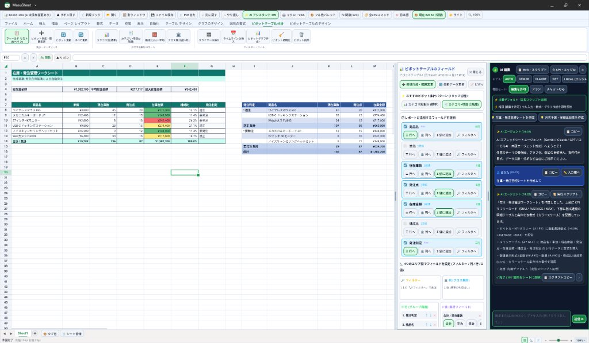
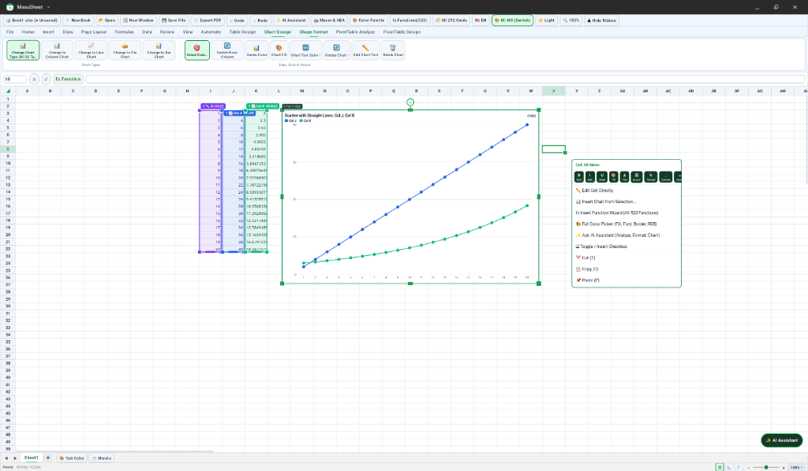
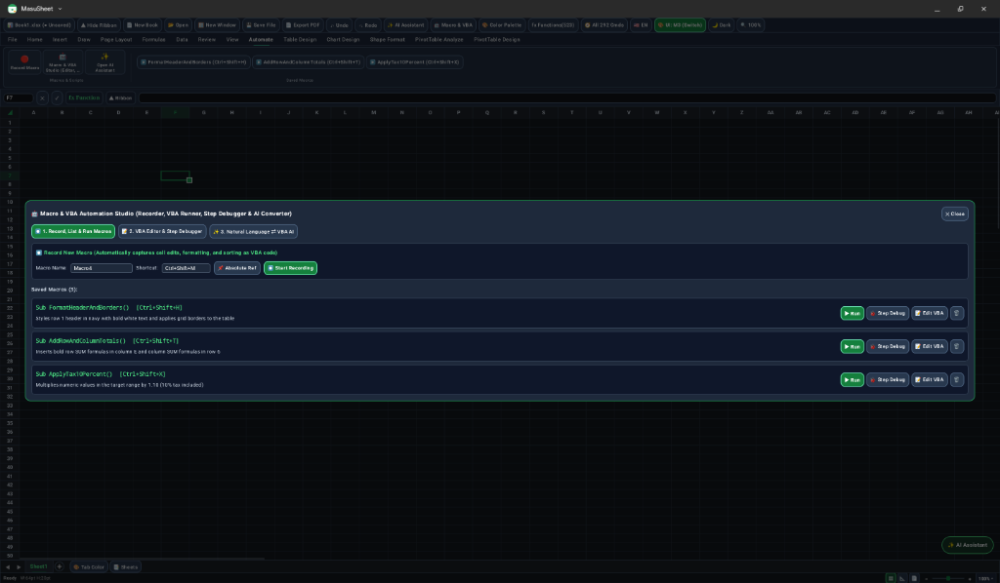
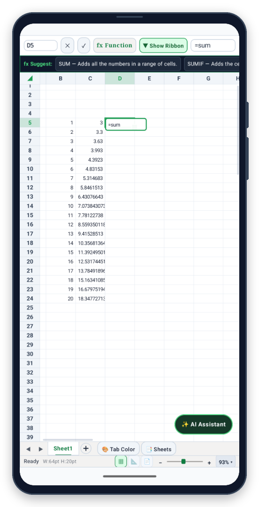

# MasuSheet（マスシート）

[](https://github.com/ray-dev-light/MasuSheet/actions/workflows/ci.yml)
[](./LICENSE-APACHE)

**[English README is available here (README.md)](./README.md)**

**MasuSheet（マスシート）** は、Rust 製スプレッドシート計算エンジン（`libmasusheet_jni.so`）、2層ハードウェアアクセラレーション `Canvas` グリッド描画、および機能別にモジュール分割された Jetpack Compose UI を組み合わせた Android 向けネイティブ表計算アプリケーションです。Android スマートフォン・折りたたみ端末・タブレット、および Googlebook OS（マルチウィンドウ環境対応）のすべてで軽快に動作するよう設計されています。



<table>
  <tr>
    <td width="42.5%" align="center" valign="top">
      
      <br />
      <sub>15タブリボン ＆ 散布図グラフ</sub>
    </td>
    <td width="42.5%" align="center" valign="top">
      
      <br />
      <sub>ダークモード ＆ マクロ・VBA</sub>
    </td>
    <td width="15%" align="center" valign="top">
      
      <br />
      <sub>スマホ表示</sub>
    </td>
  </tr>
</table>

---

## 主な機能

- **523種類のワークシート関数＆スピル配列数式**: Rust 製の高速計算コアにより、`SUMIFS`、`XLOOKUP`、`INDEX`/`MATCH`、`LET`、`LAMBDA`、`FILTER`、`SORT`、`UNIQUE`、`SEQUENCE`、財務・統計・工学・日付関数など 523 関数をサポート。数式バーでのリアルタイム補完と、セルタップによる色分け参照入力（ポイントモード）に対応しています。
- **2層ハードウェア Canvas グリッド描画（表示倍率 `25%`〜`400%`）**:
  - **Layer 1（静的セルキャッシュ）**: 4象限ウィンドウ枠の固定、画面外起点を含む結合セル、罫線、条件付き書式、スパークライン、折り返し文字列、セル内チェックボックス（`□` / `☑`）をキャッシュビットマップへ描画。
  - **Layer 2（高速オーバーレイ）**: 選択枠、行列の自動調整（AutoFit）・リサイズガイド、数式参照ハイライト、フローティング画像・図形・グラフをミリ秒未満で重ね描き。
  - **タッチ・スタイラス・マウス／キーボード操作**: 選択中セルの中央（または左上ハンドル）からのドラッグによる直感的なタッチ範囲選択、未選択エリアおよびグラフ・画像選択中のまま行える滑らかなシートスクロールに加え、ピンチ中心維持ズーム、マウスホイール／トラックパッド操作、右クリックメニュー、物理キーボードショートカットに完全対応。
- **全体表示・非表示対応15タブリボン UI ＆ Material 3 / クラシック切替**: 基本10タブ（ファイル・ホーム・挿入・描画・ページレイアウト・数式・データ・校閲・表示・自動化）＋コンテキスト5タブ（テーブルデザイン・グラフのデザイン・図形の書式・ピボットテーブル分析・ピボットテーブルのデザイン）の全292コマンドを搭載。数式バー横のボタンから1タップでリボン全体を折りたたみ／再表示でき、スマートフォンでも広いシート領域を確保可能。ライト／ダークテーマおよび Material 3／クラシック UI を即座に切り替えられます。
- **グラフ（全32サブタイプ）・図形・画像の `.xlsx` 保存＆編集ワークフロー**:
  - **10カテゴリ×32種類のグラフ**: 縦棒・折れ線・円／ドーナツ・横棒・面・散布図／バブル・レーダー・ツリーマップ／サンバースト・統計（ヒストグラム／箱ひげ）・滝／じょうご／株価／複合に対応。シート上での X軸／Y軸データ範囲ドラッグ変更、要素別（全体・タイトル・縦軸・横軸・凡例）の文字色設定、軸の最小値・最大値・目盛間隔設定を備え、作成したグラフ・画像・図形を `.xlsx` ファイルへ保存・再読み込みできます（標準OOXML（`.xlsx`）グラフ＋MasuSheet詳細設定の両対応）。
  - **画像＆図形編集**: 枠線なしのクリーンな画像貼り付け、`inSampleSize` 縮小デコード＋`LruCache` による省メモリ描画、四隅のアスペクト比維持リサイズ、辺中央の単軸リサイズ、`Shift+クリック` 複数選択と整列、矢印キー `1pt` 微調整、複数オブジェクトの統合 PNG コピーに対応。
- **ピボットテーブル＆テーブルオートフィルタ**: 新規シートまたは既存シートへのピボットテーブル作成、行・列・値（7種の集計モード：合計・個数・平均・最大・最小・積・構成比%）・フィルタ配置、小計・総計、スライサー・タイムライン・ピボットグラフ、デザインプリセット、別シート元表からの再集計に対応。
- **マクロスタジオ（VBA風構文対応）**: 操作記録、`For..Next` ループや `&` 文字列連結を含む VBA 風マクロコード編集、1行ずつのステップ実行デバッガ、統合 Undo スナップショットによる安全なロールバックを搭載。
- **3モード対応 AI スプレッドシート編集パネル**:
  1. **内蔵スマートスクリプト**: API キー不要・オフラインで動く定型集計・表作成・装飾機能。
  2. **外部 Web AI 連携**: シート構造と専用 JSON 仕様をコピーし、普段お使いの Web AI の出力 JSON を貼り付けて一括反映。
  3. **クラウド API ／ ローカル LLM (`127.0.0.1`)**: `Dispatchers.IO` 非同期通信による Gemini・OpenAI・Claude・ローカル LLM 連携（破壊的コマンドを遮断する厳格な許可リスト付き）。
- **複数ブックタブ＆別ウィンドウ分離（`:window2`）**: 複数ファイルのタブ切替に加え、グラフ・画像・ピボットテーブル・カスタム書式を100%保持したまま独立した OS ウィンドウへ分離・再統合できます。
- **日英バイリンガル UI ＆ 多形式入出力**: 日本語・英語のリアルタイム表示切替と、Android Scoped Storage（`MediaStore`）／SAF による各種ブック読込（`.xlsx` / `.xlsm`［パスワード暗号化対応］・`.xls`・`.xlsb`・`.ods`・`.csv`・`.tsv`）および保存・出力（`.xlsx` / `.xlsm`・`.csv`・`.tsv`・`.html`・`.pdf`）に対応。

---

## アーキテクチャ・モジュール構成

可読性と保守性を高めるため単一責任のモジュールへ整理し、Android アプリ層（全 Kotlin ファイル）および JNI ブリッジ（`crates/jni`）には英語（`[EN]`）と日本語（`[JA]`）の解説コメントを記載しています。

```text
MasuSheet/
├── app/src/main/java/com/masusheet/app/
│   ├── MainActivity.kt              # メインActivity ＆ マルチウィンドウ用 SecondaryWorkbookActivity
│   ├── core/                        # 全体設定・厳密A1番地パーサ・60色テーマパレット・数式ポイントモード・日英翻訳辞書
│   ├── storage/                     # Android Keystore AES-256-GCM 暗号化保管・SAF/MediaStore入出力・UUIDハンドオフ
│   ├── model/                       # ビューポート不変スナップショット・シートオブジェクト・ピボット定義・UI状態
│   ├── bridge/                      # マルチセッション対応 Rust JNI ゲートウェイ ＆ 純粋Kotlinフォールバックエンジン
│   ├── catalog/                     # 全15タブ/292コマンド・全523関数・全32種グラフサブタイプのカタログ定義
│   ├── ai/                          # 3モードAIエージェント ＆ マクロ/VBA解析・ステップ実行エンジン
│   ├── viewmodel/                   # 機能分割された MasuSheetViewModel 群（ブック別統合 Undo/Redo 制御）
│   ├── canvas/                      # 2層Canvasグリッド・4象限セル/グラフ描画レンダラ・日本語IME待機コンテナ
│   └── ui/                          # メイン画面・15タブリボン・数式バー/シートタブバー・各種設定ダイアログ群
└── crates/
    ├── core/ numfmt/ formula/ functions/ calc/ model/ xlsx/ chart/ pdf/ engine/   # Rust 計算エンジンコア
    └── jni/                         # パニック安全（`catch_unwind`）・マルチセッション対応 JNI ブリッジ
```

---

## セキュリティ設計・Google Play プロテクト準拠

- **最小権限の原則**: 宣言権限は任意の AI API 通信用の `android.permission.INTERNET` **1つのみ**です。広範なストレージ権限（`MANAGE_EXTERNAL_STORAGE` 等）、カメラ、マイク、バックグラウンドサービス等は一切要求せず、ファイル入出力はすべてユーザー選択の SAF / `MediaStore` 経由で行います。
- **API キーのハードウェア保護**: AI 用の API キーは **Android Keystore** の AES-256-GCM 鍵で暗号化して保存し、クラウドバックアップ・端末間転送から除外（`data_extraction_rules.xml` / `backup_rules.xml`）したうえで、URL クエリではなく HTTP ヘッダで送信します。
- **通信とプロセス境界の保護**: `usesCleartextTraffic="false"` により外部への平文 HTTP 通信を遮断（ローカル LLM 用の `127.0.0.1` / `localhost` のみ許可）。内部 Activity や `ContentProvider` は `exported="false"` で非公開化し、別ウィンドウ引き継ぎにはワンタイム UUID トークンを使用します。
- **ネイティブ境界の安全性**: 計算コア全10クレートで `unsafe_code = "forbid"` を強制し、JNI ブリッジ（`crates/jni`）でも8個のエクスポート宣言以外に `unsafe` を禁止（`unsafe_op_in_unsafe_fn = "forbid"`）したうえで全境界を `std::panic::catch_unwind` で保護しています。

---

## ビルドとテスト手順

### 必要環境
- **JDK 17**
- **Android SDK**（`compileSdk = 36`, `minSdk = 26`, `targetSdk = 35`）
- **Rust stable ツールチェーン**（`app/src/main/jniLibs/` に同梱済みの `arm64-v8a` / `x86_64` バイナリをそのまま使う場合は不要、`crates/` を再ビルドする場合に使用）

### Rust 計算コア＆JNI テスト
```bash
cargo test --workspace
```

### Android 単体テスト・Lint・デバッグ APK ビルド
```bash
./gradlew testDebugUnitTest lintDebug assembleDebug
```

### 署名付きリリース APK ビルド
秘密鍵（`.jks`）はリポジトリに含めず、環境変数から注入します：
```bash
export MASUSHEET_KEYSTORE_FILE="/path/to/release.jks"
export MASUSHEET_KEYSTORE_PASSWORD="your_store_password"
export MASUSHEET_KEY_ALIAS="masusheet_release"
export MASUSHEET_KEY_PASSWORD="your_key_password"

./gradlew assembleRelease
```

---

## ライセンスと謝辞（OSS Attribution）

MasuSheet は以下のデュアルライセンスのもとで提供されます（いずれかを選択可能）：

- **Apache License, Version 2.0** ([LICENSE-APACHE](./LICENSE-APACHE))
- **MIT License** ([LICENSE-MIT](./LICENSE-MIT))

本プロジェクトの Rust 計算エンジンクレート群（`crates/*`）は、**ArtCraft** によるオープンソースプロジェクト **GridCraft** をベースに構築されています。MasuSheet は独立したオープンソースプロジェクトであり、ArtCraft による公式製品・提携プロジェクトではありません。各種オープンソースライセンス全文および著作権表示はアプリ内（`ファイル` タブ → `📜 OSSライセンス・このアプリについて`）に同梱されているほか、[NOTICE](./NOTICE) および [ATTRIBUTION.md](./ATTRIBUTION.md) でもご確認いただけます。

> **商標について**: Microsoft、Excel、Visual Basic、SmartArt、WordArt、Copilot は Microsoft グループ企業の商標または登録商標です。Google、Android、Googlebook、Googlebook OS、および Google スプレッドシートは Google LLC の商標です。その他記載されている会社名・製品名は各社の商標または登録商標であり、本ドキュメントおよびアプリ内ではファイル形式（`.xlsx` / ECMA-376 OOXML）・対応環境・構文の互換性説明の目的にのみ言及しています。MasuSheet は Microsoft Corporation および Google LLC と提携・承認関係にはありません。
