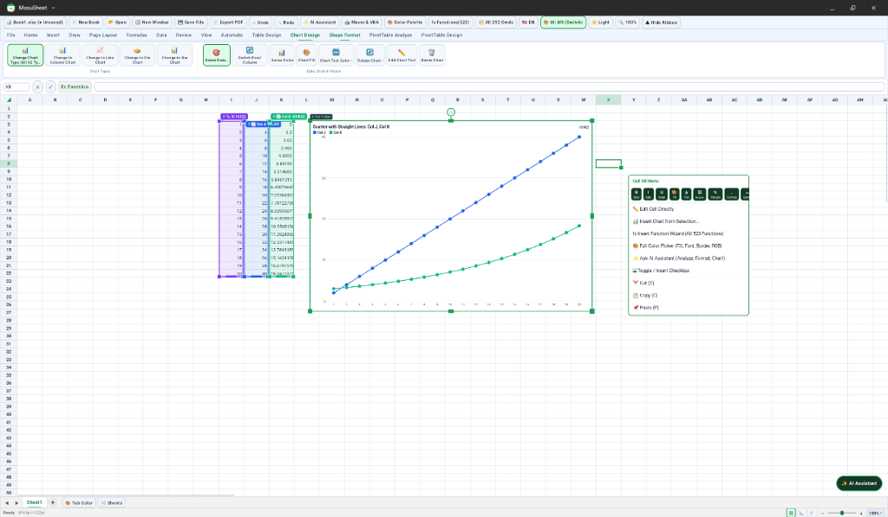

# MasuSheet

[](https://github.com/ray-dev-light/MasuSheet/actions/workflows/ci.yml)
[](./LICENSE-APACHE)

**[日本語版 README はこちら (README.ja.md)](./README.ja.md)**

**MasuSheet** ("Masu" = grid cell in Japanese) is a high-performance native Android spreadsheet application powered by a Rust calculation engine (`libmasusheet_jni.so`), a 2-layer hardware-accelerated Android `Canvas` sheet view, and a modular Jetpack Compose UI. Designed from the ground up for Android smartphones, foldables, tablets, and Googlebook OS (including multi-window environments).



---

## Key Features

- **523 Worksheet Functions & Dynamic Arrays**: Full formula evaluation engine written in Rust (`SUMIFS`, `XLOOKUP`, `INDEX`/`MATCH`, `LET`, `LAMBDA`, `FILTER`, `SORT`, `UNIQUE`, `SEQUENCE`, financial, statistical, engineering, and date/time functions) with live formula-bar auto-complete and interactive cell/range point-mode highlighting.
- **2-Layer Hardware Canvas Grid (`25%`–`400%` Zoom)**:
  - **Layer 1 (Static Cell Cache)**: Renders 4-quadrant Freeze Panes, merged cells (including off-screen anchors), borders, conditional formatting, sparklines, wrapped text, and interactive checkboxes (`□` / `☑`) to a cached hardware bitmap.
  - **Layer 2 (Interactive Overlay)**: Sub-millisecond rendering of cell selections, row/column AutoFit & resize guides, formula reference highlights, floating images, shapes, and charts.
  - **Touch, Stylus, & Mouse/Keyboard Input**: Drag directly from the active cell (or top-left selection handle) to expand cell selections by touch, swipe unselected areas — or swipe while keeping charts/images/shapes selected — to scroll smoothly, and show/hide the entire ribbon in one tap; full support for focal-point pinch-to-zoom, mouse wheel / trackpad gestures, right-click context menus, and hardware keyboard shortcuts.
- **15-Tab Full Ribbon (Collapsible) & Material 3 / Classic UI Toggle**: Core tabs (File, Home, Insert, Draw, Page Layout, Formulas, Data, Review, View, Automate) plus contextual tabs (Table Design, Chart Design, Shape Format, PivotTable Analyze, PivotTable Design) across 292 commands — collapsible in full via a 1-tap formula-bar toggle to maximize mobile sheet space, and switchable live between Material 3 and Classic layouts in both Light and Dark themes.
- **Charts, Shapes, & Lossless `.xlsx` / Image Workflow**:
  - **10 Categories × 32 Chart Subtypes**: Column, Line, Pie/Doughnut, Bar, Area, XY Scatter, Stock, Radar, Combo, and Waterfall charts with on-sheet X/Y source range handles, per-element text color customization, finite-safe axis formatting, and full `.xlsx` save/reopen persistence (both native ECMA-376 OOXML charts and lossless MasuSheet metadata).
  - **Floating Images & Shapes**: Borderless clipboard/file image insertion with automatic `inSampleSize` downsampling & `LruCache` memory protection, 4-corner aspect-locked resize, mid-edge single-axis resize, `Shift+Click` multi-select alignment, `1pt` arrow-key nudge, and combined PNG export.
- **PivotTables & Table AutoFilter**: Create PivotTables on new or existing worksheets with Row, Column, Value (11 aggregation modes), and Filter areas, subtotals/grand totals, style presets, and cross-sheet source refresh.
- **Macro Studio (VBA-Style Automation)**: Record actions into macros, edit and expand `For..Next` VBA-style loops, step through statements line-by-line in the debugger, and safely roll back macro runs via synchronized Undo snapshots.
- **3-Mode AI Spreadsheet Assistant**:
  1. **Built-in Smart Script**: Offline deterministic table generation, totals, and formatting.
  2. **Web AI Bridge**: Copy structured sheet context + JSON schema to any browser AI and paste back the JSON plan.
  3. **Cloud API & Local Edge LLM**: Asynchronous `Dispatchers.IO` execution against Gemini, OpenAI, Anthropic, or local loopback servers (`http://127.0.0.1:11434`) with strict command allowlisting.
- **Multi-Workbook Tabs & Multi-Window (`:window2`)**: Open multiple workbooks in tabs, detach any workbook into an independent OS window preserving all charts, images, PivotTables, and custom styles, and merge windows back seamlessly.
- **Full Bilingual UI (`JA` / `EN`) & Document I/O**: Instant runtime switching between Japanese and English; `.xlsx`, `.csv`, `.tsv`, `.ods`, `.html`, and `.pdf` import/export via Android Scoped Storage (`MediaStore`) and Storage Access Framework (SAF).

---

## Architecture & Module Layout

MasuSheet separates UI, state orchestration, rendering, storage, and native calculation into focused, human-readable modules with bilingual (`[EN]` / `[JA]`) KDoc documentation:

```text
MasuSheet/
├── app/src/main/java/com/masusheet/app/
│   ├── MainActivity.kt              # Entry Activity & SecondaryWorkbookActivity (:window2)
│   ├── core/                        # Config, strict A1 parser, 60-color palette, Point-Mode, JA/EN I18n
│   ├── storage/                     # Android Keystore AES-256-GCM SecretStore, SAF/MediaStore I/O, UUID handoff
│   ├── model/                       # Immutable viewport snapshots, sheet objects, PivotTables, UI state
│   ├── bridge/                      # Multi-session Rust JNI gateway & pure-Kotlin test fallback engine
│   ├── catalog/                     # 15-tab / 292-command, 523-function, & 32-chart-subtype catalogs
│   ├── ai/                          # 3-mode SpreadsheetAiAgent & MacroStudioEngine (VBA parser/debugger)
│   ├── viewmodel/                   # Modular MasuSheetViewModel + domain extensions & unified Undo/Redo
│   ├── canvas/                      # 2-layer MasuSheetNativeGridView, 4-quadrant renderer, & IME container
│   └── ui/                          # Compose workspace screen, 15-tab ribbon, formula/tab bars, & dialogs
└── crates/
    ├── core/ formula/ functions/ calc/ model/ xlsx/ chart/ engine/   # Rust calculation core
    └── jni/                         # Panic-safe (`catch_unwind`) multi-session JNI bridge (`libmasusheet_jni`)
```

---

## Security & Google Play Protect Compliance

- **Minimal Permissions**: Declares **only** `android.permission.INTERNET` (required solely when the user configures an optional AI API endpoint). Zero broad storage (`MANAGE_EXTERNAL_STORAGE`), camera, microphone, or background service permissions; all file access uses user-driven SAF / `MediaStore`.
- **Hardware-Backed API Key Encryption**: User-supplied AI API keys are encrypted at rest with **AES-256-GCM** using keys bound to the **Android Keystore**, excluded from cloud backup and device-to-device transfer (`data_extraction_rules.xml` / `backup_rules.xml`), and transmitted via request headers (never URL query strings).
- **Network Transport Hardening**: `android:usesCleartextTraffic="false"` globally; `network_security_config.xml` permits cleartext HTTP exclusively to `127.0.0.1` / `localhost` for on-device Edge LLMs.
- **Process & Intent Isolation**: Secondary activities and `ContentProvider` components are non-exported (`android:exported="false"`), `file://` intent schemes are disabled, and multi-window transfers use one-time canonical UUID capability tokens inside `cacheDir/handoff/`.
- **Panic-Safe Native Boundary**: `#![forbid(unsafe_code)]` across workspace Rust crates (with `#![deny(unsafe_op_in_unsafe_fn)]` and `std::panic::catch_unwind` at every JNI boundary in `crates/jni`).

---

## Building & Testing

### Prerequisites
- **JDK 17**
- **Android SDK** (`compileSdk = 36`, `minSdk = 26`, `targetSdk = 35`)
- **Rust stable toolchain** (optional when using prebuilt `arm64-v8a` / `x86_64` `.so` libraries in `app/src/main/jniLibs/`; required when modifying `crates/`)

### Run Rust Engine & JNI Tests
```bash
cargo test --workspace
```

### Run Android Unit Tests, Lint, & Debug APK Build
```bash
./gradlew testDebugUnitTest lintDebug assembleDebug
```

### Build Signed Release APK
Configure your external keystore via environment variables (never commit `.jks` files to Git):
```bash
export MASUSHEET_KEYSTORE_FILE="/path/to/release.jks"
export MASUSHEET_KEYSTORE_PASSWORD="your_store_password"
export MASUSHEET_KEY_ALIAS="masusheet_release"
export MASUSHEET_KEY_PASSWORD="your_key_password"

./gradlew assembleRelease
```

---

## License & Attribution

MasuSheet is dual-licensed under either of:

- **Apache License, Version 2.0** ([LICENSE-APACHE](./LICENSE-APACHE))
- **MIT License** ([LICENSE-MIT](./LICENSE-MIT))

at your option.

MasuSheet's Rust calculation engine crates (`crates/*`) are derived from the open-source **GridCraft** spreadsheet engine by **ArtCraft**. MasuSheet is an independent open-source Android project and is not affiliated with or endorsed by ArtCraft. Full open-source notices and third-party license texts are bundled inside the APK (`File` -> `About & OSS Licenses`) as well as in [NOTICE](./NOTICE) and [ATTRIBUTION.md](./ATTRIBUTION.md).

> **Trademark Notice**: Microsoft, Excel, Visual Basic, SmartArt, WordArt, and Copilot are trademarks of the Microsoft group of companies. Google, Android, ChromeOS, Chromebook, and Google Sheets are trademarks of Google LLC. All other trademarks and product names are the property of their respective owners and are referenced solely to describe file-format (`.xlsx` / ECMA-376 OOXML) or syntax interoperability. MasuSheet is not affiliated with, sponsored by, or endorsed by Microsoft Corporation or Google LLC.
